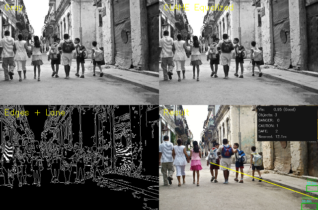

# Monocular Forward Collision Warning

**단안 카메라 기반 전방 충돌 위험 탐지 시스템 — 딥러닝 없이 고전 영상처리만으로**


카메라 한 대로 찍은 주행 영상에서 전방 객체를 검출하고, 거리·충돌 예상 시간(TTC)·차선 정보를 바탕으로
위험도를 **SAFE / CAUTION / DANGER** 세 등급으로 나눕니다.
학습 데이터나 신경망 없이 OpenCV의 고전 기법(엣지, 컨투어, Hough, Watershed, Harris/SIFT/HoG, Lucas-Kanade, 핀홀 카메라 모델)만 씁니다.

| 주행 영상 처리 결과 (DANGER 장면) | 주행 영상 처리 결과 (일반 장면) |
|:---:|:---:|
|  |  |

> 충북대학교 전자공학부 「산업 컴퓨터비전」(황영배 교수님) 중간·기말 프로젝트를 하나로 정리한 저장소입니다.

---

## 목차

1. [문제와 목표](#1-문제와-목표)
2. [버전 구성: Midterm → Final](#2-버전-구성-midterm--final)
3. [전체 파이프라인 (Final)](#3-전체-파이프라인-final)
4. [위험도 평가 공식](#4-위험도-평가-공식)
5. [검증 결과](#5-검증-결과)
6. [빠른 시작](#6-빠른-시작)
7. [디렉토리 구조](#7-디렉토리-구조)
8. [강의 기법 ↔ 모듈 매핑](#8-강의-기법--모듈-매핑)
9. [한계와 향후 과제](#9-한계와-향후-과제)
10. [데이터 출처](#10-데이터-출처)

---

## 1. 문제와 목표

LiDAR나 스테레오 카메라 없이, **단안 카메라 하나로** 전방 위험을 판단할 수 있을까?

- 별도 학습 데이터 없이 **순수 영상처리 기법만** 사용
- 강의 3~12주차에서 배운 기법을 하나의 파이프라인으로 통합
- 실시간 처리가 가능한 경량 구현 (주행 영상 기준 약 50 fps)

출발점은 세 가지 가정입니다.

| 가정 | 근거 |
|------|------|
| 가까울수록 위험하다 | 원근법상 가까운 물체일수록 이미지 속에서 크게 보인다 (Final에서는 핀홀 모델로 거리를 m 단위로 추정) |
| 정면에 있을수록 위험하다 | 직진 중에는 화면 중앙의 물체와 충돌할 확률이 가장 높다 |
| 시인성이 낮을수록 위험하다 | 야간·역광에서는 반응 시간이 줄어 같은 거리라도 더 위험하다 |

---

## 2. 버전 구성: Midterm → Final

이 저장소는 두 단계로 나뉩니다. 각 폴더에 상세 문서가 따로 있습니다.

| | [Midterm_exam](Midterm_exam/README.md) — v1 기본 파이프라인 | [Final_exam](Final_exam/README.md) — v2 고도화 (Phase 1~6) |
|---|---|---|
| 입력 | 이미지 시퀀스 (KITTI) | 이미지 + **동영상** |
| 전처리 | 전역 Histogram Equalization | 저시인성일 때만 **CLAHE** 적용 |
| 객체 검출 | Canny + Contour / Otsu + Connected Component | 같은 방식 + **Watershed**로 겹친 객체 분리 + 통계적 이상치 제거 |
| 차선 | 없음 | **HoughLinesP + fitLine**으로 좌/우 차선과 차선 내부 마스크 |
| 특징점 | Harris·SIFT를 화면에 표시만 함 | Harris·SIFT·**HoG**를 위험도에 10% 반영 |
| 객체 분류 | 없음 | **HOG+SVM** 보행자 검출 + 종횡비 휴리스틱 → vehicle / pedestrian |
| 추적 | 없음 | **Lucas-Kanade Optical Flow** + IoU 매칭, 트랙 ID와 속도 벡터 |
| 거리 | 객체 면적으로 간접 추정 | **핀홀 카메라 모델** `Z = H_real × fy / H_pixel` (m 단위) |
| 충돌 예상 시간 | 없음 | 박스 면적 변화율로 **TTC** 산출 |
| 위험도 | 크기·중앙거리 × 시인성 | 거리·중앙거리·특징 × 시인성 × TTC × 차선 |
| 출력 | 화면 + PNG | PNG + **MP4** + **CSV 통계** |

| Midterm 결과 (KITTI) | Final 디버그 패널 (Gray / CLAHE / Edges+Lane / Result) |
|:---:|:---:|
|  |  |

---

## 3. 전체 파이프라인 (Final)

```
단안 카메라 영상 (이미지 / 동영상)
        │
        ▼
[1] preprocessing.py  Gray 변환 → 시인성 점수 → (저시인성이면 CLAHE) → Gaussian → Canny
        │
        ▼
[2] lane.py           하단 ROI → HoughLinesP → 기울기로 좌/우 분리 → fitLine → 차선 마스크
        │
        ▼
[3] detection.py      Canny + Morphology + Contour (실패 시 Otsu + ConnectedComponents)
                      → Watershed (IoU > 0.4 쌍 분리) → 통계적 이상치 제거
        │
        ├──▶ feature.py     Harris · SIFT · HoG 특징량
        └──▶ classifier.py  HOG+SVM 보행자 검출 → vehicle / pedestrian 분류
        │
        ▼
[4] tracking.py       IoU 매칭 + LK Optical Flow → 트랙 ID · 속도 · TTC
        │
        ▼
[5] calibration.py    camera_mat.npy (fy = 613.0) → 클래스별 실제 높이로 거리(m) 추정
        │
        ▼
[6] risk.py           거리 · 중앙거리 · 특징 점수 × 시인성 · TTC · 차선 가중치 → 등급
        │
        ▼
[7] visualize.py      박스 · 클래스 · 거리 · TTC · 속도 화살표 · HUD · DANGER 배너
        │
        ▼
     PNG / MP4 / CSV 저장
```

---

## 4. 위험도 평가 공식

### v1 (Midterm)

```
score = (0.5 × size_score + 0.5 × center_score) × vis_weight
```

### v2 (Final)

```
size_score    = clip(1 - (distance_m - 5) / 45, 0, 1)     # 5m → 1.0, 50m → 0.0 (거리 미산출 시 면적 기반)
center_score  = 1 - clip(√(dx² + dy²) / √2, 0, 1)          # 화면 중앙일수록 1.0
feature_score = 0.5 × clip((harris + sift) / 500, 0, 1) + 0.5 × clip(hog × 10, 0, 1)

vis_weight    = 1.0 + 0.3 × (1 - vis_score)                # 1.00 ~ 1.30
ttc_weight    = 1.0 + 0.4 × max(0, 1 - ttc / 3)            # 1.00 ~ 1.40 (TTC < 3s일 때 증가)
lane_weight   = 1.1 (차선 안) / 0.85 (차선 밖)

base  = 0.45 × size + 0.45 × center + 0.10 × feature
score = clip(base × vis_weight × ttc_weight × lane_weight, 0, 1)
```

| 등급 | 점수 | 표시 색 |
|------|------|------|
| DANGER | ≥ 0.60 | 빨강 |
| CAUTION | 0.35 ~ 0.60 | 주황 |
| SAFE | < 0.35 | 초록 |

---

## 5. 검증 결과

공개 대시캠 주행 영상(72초, 640×360, 24fps)에 Final 파이프라인을 적용했습니다 (`--skip 3`).

| 항목 | 결과 |
|------|------|
| 처리 프레임 | 578 프레임 (원본 1,734 프레임) |
| 처리 속도 | **약 50 fps** (72초 영상을 11.5초에 처리) |
| 평균 객체 수 | 5.3개 / 프레임 |
| 클래스별 검출 | vehicle 2,911건 · pedestrian 160건 |
| 등급별 누적 | DANGER 352 · CAUTION 1,206 · SAFE 1,513 |
| 추정 거리 | 최근접 4.1m · 평균 18.1m · 최원 61.3m |
| TTC 산출 구간 | 278 / 578 프레임 (48.1%), 평균 2.53s |

결과 영상과 프레임별 통계는 [Final_exam/output/open_dataset/](Final_exam/output/open_dataset/)에 있습니다.

- `result.mp4` — 주석이 그려진 결과 영상
- `stats.csv` — 프레임별 시인성, 객체 수, 등급별 개수, 최근접 거리, 최소 TTC
- `danger_moments/` — TTC가 가장 짧았던 12장면
- `overview/` — 8초 간격 요약 9장

---

## 6. 빠른 시작

### 설치

```bash
git clone https://github.com/cbnu-yhjeon/monocular-forward-collision-warning.git
cd monocular-forward-collision-warning
pip install -r requirements.txt
```

`cv2.SIFT_create`를 쓰므로 OpenCV 4.4 이상이 필요합니다 (개발 환경: OpenCV 4.13.0).

### Final — 주행 영상 처리

```bash
cd Final_exam/src
python3 process_video.py --input ../../Data/open_dataset/driving_2CIxM7x-Clc.mp4 --skip 3

# 빠른 확인: 100 프레임만, 보행자 검출 끔
python3 process_video.py --input ../../Data/open_dataset/driving_2CIxM7x-Clc.mp4 --max 100 --no-ped
```

입력 파일 옆에 `<입력명>_result.mp4`와 `<입력명>_stats.csv`가 생성됩니다.

### Final — 이미지 뷰어 모드

```bash
cd Final_exam/src
python3 main.py --data ../../Data                      # Data/ 안의 이미지 전체
python3 main.py --data ../../Data/people.jpg --debug   # 4분할 디버그 패널
python3 main.py --data ../../Data --save --video --csv # PNG + MP4 + CSV 저장
```

키 조작: `d`/`→` 다음, `a`/`←` 이전, `s` 저장, `q` 종료

### Midterm — KITTI 이미지 시퀀스

KITTI 데이터셋은 용량 문제로 저장소에 포함하지 않았습니다.
[KITTI Vision Benchmark](https://www.cvlibs.net/datasets/kitti/)에서 Raw Data 시퀀스의 좌측 컬러 이미지(`image_02/data/*.png`)를 받아 `Midterm_exam/dataset/`에 넣은 뒤 실행합니다.

```bash
cd Midterm_exam/src
python3 main.py --debug   # 전처리 4분할 패널
python3 main.py --save    # 결과를 output/에 저장
```

전체 CLI 옵션은 [Final_exam/README.md](Final_exam/README.md#9-의존성-및-파라미터)와 [Midterm_exam/README.md](Midterm_exam/README.md#실행-방법)에 정리되어 있습니다.

---

## 7. 디렉토리 구조

```
monocular-forward-collision-warning/
├── README.md
├── requirements.txt
├── Midterm_exam/              v1 기본 파이프라인
│   ├── README.md              개념 설명, 검출·위험도 상세, 한계와 향후 연구
│   ├── src/                   main · preprocessing · detection · feature · risk · visualize
│   └── output/                KITTI 처리 결과와 디버그 패널
├── Final_exam/                v2 고도화 파이프라인 (Phase 1~6)
│   ├── README.md              Midterm 대비 변경점, 강의 매핑, 모듈별 알고리즘
│   ├── src/                   + lane · classifier · tracking · calibration · process_video
│   └── output/
│       ├── result_*.png, debug_*.png, stats.csv   이미지 모드 결과
│       └── open_dataset/      주행 영상 결과 (mp4, csv, 대표 장면)
└── Data/
    ├── 0.jpg, 1.jpg, people.jpg   이미지 모드 테스트 입력
    ├── pinhole_calib/             카메라 내부 파라미터 (camera_mat.npy, dist_coefs.npy)
    └── open_dataset/              공개 대시캠 주행 영상과 샘플 프레임
```

---

## 8. 강의 기법 ↔ 모듈 매핑

| 강의 | 기법 | 사용 모듈 |
|------|------|----------|
| Lec 3 영상처리 기초 | 색공간 변환, 히스토그램 평탄화, CLAHE, Gaussian | `preprocessing.py` |
| Lec 5 경계 검출 | Canny, Morphology, Contour, Hough Transform, Otsu, Connected Component | `detection.py`, `lane.py` |
| Lec 6 세그멘테이션 | Watershed, Distance Transform | `detection.py` |
| Lec 7 특징점 | Harris Corner, SIFT | `feature.py`, `risk.py` |
| Lec 8 머신러닝 | SVM, NMS, 이상치 제거 | `classifier.py`, `detection.py` |
| Lec 9 광학 흐름 | Good Features to Track, Pyramidal Lucas-Kanade | `tracking.py` |
| Lec 10 카메라 기하 | 핀홀 카메라 모델, 캘리브레이션 파라미터, 왜곡 보정 | `calibration.py` |
| Lec 12 객체 검출 | HoG 디스크립터, HOG+SVM 보행자 검출 | `feature.py`, `classifier.py` |

---

## 9. 한계와 향후 과제

**현재 한계**

- **거리 추정은 가정에 의존합니다.** 핀홀 모델은 클래스별 평균 높이(차량 1.5m, 보행자 1.7m)를 가정하므로, 바운딩 박스 높이가 실제 물체와 어긋나면 거리도 어긋납니다. 캘리브레이션 파라미터도 주행 영상을 찍은 카메라가 아니라 실습용 카메라의 값입니다.
- **오검출이 있습니다.** 엣지 기반 검출이라 도로변 수풀이나 그림자처럼 텍스처가 강한 배경을 객체로 잡는 경우가 있습니다 (위 결과 이미지 좌측의 PED 박스 참고).
- **TTC는 연속 추적이 될 때만 나옵니다.** 박스 면적 변화율에 의존하므로 박스 크기가 흔들리면 TTC도 흔들립니다. 단일 이미지에서는 N/A입니다.
- **검증 데이터가 적습니다.** 정량 평가는 주간·양호 조명 영상 한 편에서 했고, 정답 라벨과 비교한 정확도는 측정하지 않았습니다.

**향후 과제**

- 검출 단계를 YOLO 같은 CNN 검출기로 교체하되, 나머지 파이프라인(거리·TTC·위험도)은 유지
- MiDaS / Depth Anything 같은 단안 깊이 추정으로 거리 점수 보강
- 주행 영상 카메라로 직접 캘리브레이션하고, KITTI 라벨로 검출·거리 오차를 정량 평가
- 야간·우천 영상(BDD100K 등)으로 CLAHE와 시인성 가중치 검증

---

## 10. 데이터 출처

| 데이터 | 출처 | 비고 |
|------|------|------|
| `Data/open_dataset/driving_2CIxM7x-Clc.mp4` | [YouTube](https://www.youtube.com/watch?v=2CIxM7x-Clc) (CC 라이선스) | Final 검증용 대시캠 영상 |
| KITTI Raw Data | [cvlibs.net](https://www.cvlibs.net/datasets/kitti/) | Midterm 입력, 저장소에 미포함 |
| `Data/pinhole_calib/*.npy` | 강의 10주차 체스보드 캘리브레이션 결과 | fx=613.6, fy=613.0, cx=331.2, cy=235.0 |
